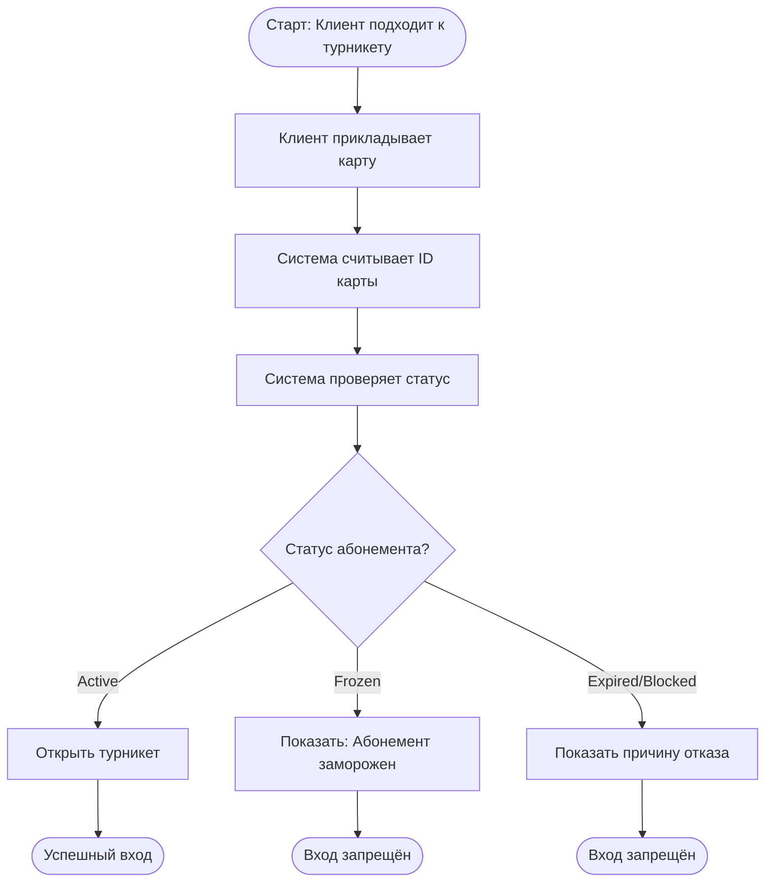
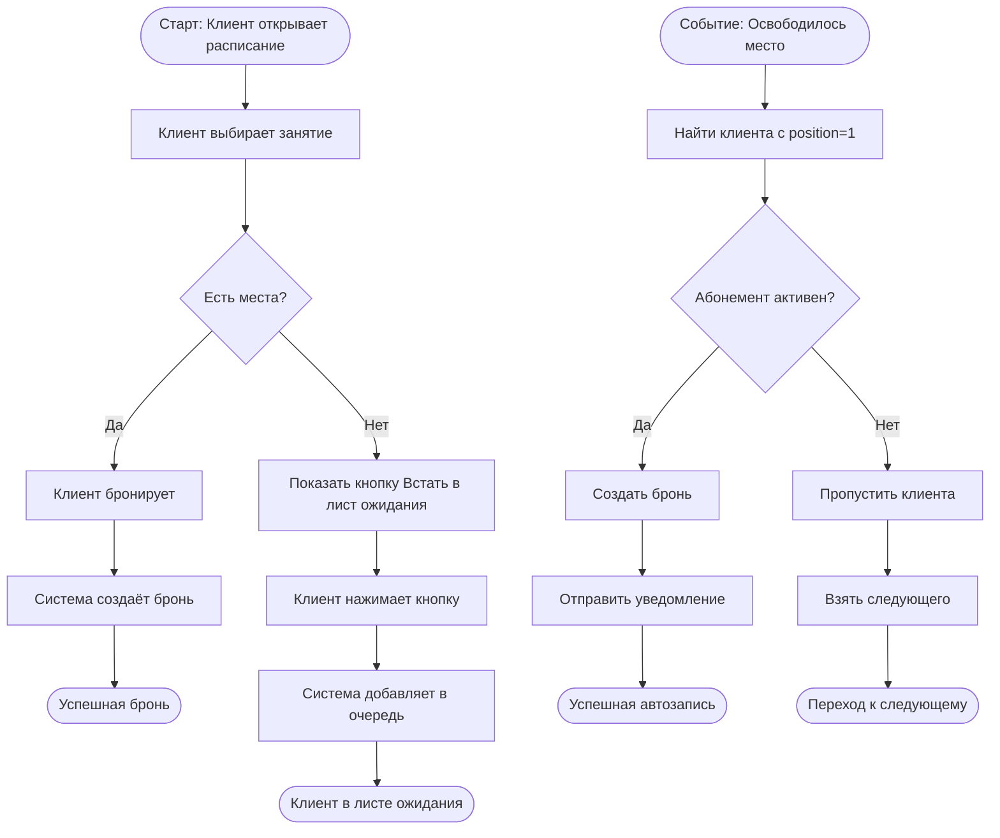

# ️ Информационная система для фитнес-клуба "Сила"

**Дипломный проект профессиональной переподготовки**  
ТГУ + АНО ДПО «ЦМИППК»  
«Системный аналитик: с нуля до проектирования систем» (256 ч)

**Выполнила:** Кормачёва Юлия Александровна  
**Поток:** САС-101  
**Преподаватель:** Накостоев Адам Махмудович

---

## 📌 Описание проекта

Разработана спецификация требований (SRS) и спроектирована информационная система для управления фитнес-клубом. Система включает:
- Контроль доступа по картам с интеграцией турникета
- Бронирование групповых занятий и персональных тренировок
- Лист ожидания с автоматической записью
- Управление абонементами и картами клиентов
- Отчётность для директора и администратора

---

## 🛠 Артефакты системного анализа

### 1. Требования
- **Функциональные требования** (ФТ-01 — ФТ-11)
- **Нефункциональные требования** (производительность, безопасность)
- **Бизнес-правила** (R-01 — R-23)
- **User Stories** и **Use Cases**

### 2. Моделирование процессов (BPMN)
- Процесс «AS IS» (текущий)
- Процесс «TO BE» (автоматизированный)
- Точки автоматизации
### 2.1. Процесс: Вход и выход клиента в зал (To-Be)

### 2.2. Процесс: Бронирование занятия и лист ожидания (To-Be)**

### 3. Моделирование данных (UML/ER)
- **ER-диаграмма** — сущности и связи
- **Диаграмма классов**
- **Диаграмма состояний**
- **Диаграмма последовательностей**

### 4. Спецификация API
- **Интеграция с турникетом** (REST API, JSON)
- **Платёжный шлюз** (REST API)
- **Модуль уведомлений** (push/SMS/email)

### 5. CRUD-матрица
Операции над сущностями по сценариям:
- Вход по карточке
- Бронирование занятий
- Лист ожидания
- Персональные тренировки

### 6. SQL-запросы
Примеры запросов для:
- Поиска дубликатов email
- Управления листом ожидания
- Расчёта выручки
- Проверки статуса абонемента

---

## 📁 Структура проекта

tgu-fitness-club-system/
── Кормачёва_SRS_фитнес-клуб_Сила.pdf # Полная спецификация
├── Кормачёва_Ю_САС-101_ИАР.docx # Итоговая аттестационная работа
└── images/ # Диаграммы
├── bpmn_as_is.png
├── bpmn_to_be.png
├── er_diagram.png
├── uml_class.png
└── sequence_diagram.png

---

## 🎓 Ключевые результаты

### Сущности системы:
- **Клиент** (Client)
- **Карточка** (Card)
- **Абонемент** (Membership)
- **Занятие** (Class)
- **Бронь** (Booking)
- **Лист ожидания** (Waitlist)
- **Тренер** (Trainer)
- **Персональная тренировка** (PersonalTraining)

### Основные функции:
✅ Выпуск/блокировка карт доступа  
✅ Проверка активного абонемента при входе  
✅ Бронирование занятий (7 дней вперёд)  
✅ Отмена брони (не позднее чем за 2 часа)  
✅ Автоматическая запись из листа ожидания  
✅ Фиксация входа/выхода через турникет  
✅ Уведомления (push/SMS/email)  
✅ Отчётность по выручке и загруженности залов

---

## 💡 Навыки, продемонстрированные в проекте

- **Сбор и формализация требований** — интервью со стейкхолдерами, анализ бизнес-процессов
- **Моделирование BPMN** — выявление узких мест, проектирование TO BE
- **Проектирование БД** — нормализация, ER-моделирование
- **UML-диаграммы** — Class, Sequence, State Machine
- **API-интеграции** — REST, JSON, спецификации эндпоинтов
- **CRUD-анализ** — матрица операций
- **SQL** — примеры запросов

---

## 📄 Документы

- [Полная спецификация SRS (PDF)](Кормачёва_SRS_фитнес-клуб_Сила.pdf)
- [Итоговая аттестационная работа (DOCX)](Кормачёва_Ю_САС-101_ИАР.docx)

---

## 👤 Автор

**Кормачёва Юлия Александровна**
-  Портфолио: [github.com/yul13166759/portfolio-julia-kormacheva](https://github.com/yul13166759/portfolio-julia-kormacheva)
- 📧 Email: [ykormacheva13166759@gmail.com]
- 📱 Telegram: [@Juliya_3105]
- 
