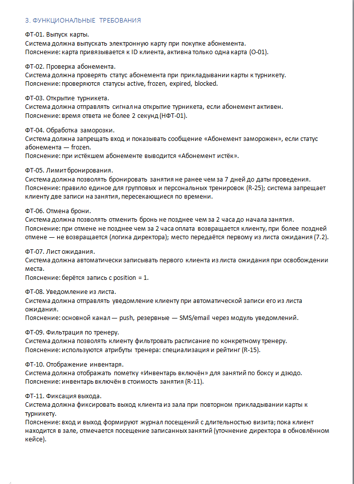
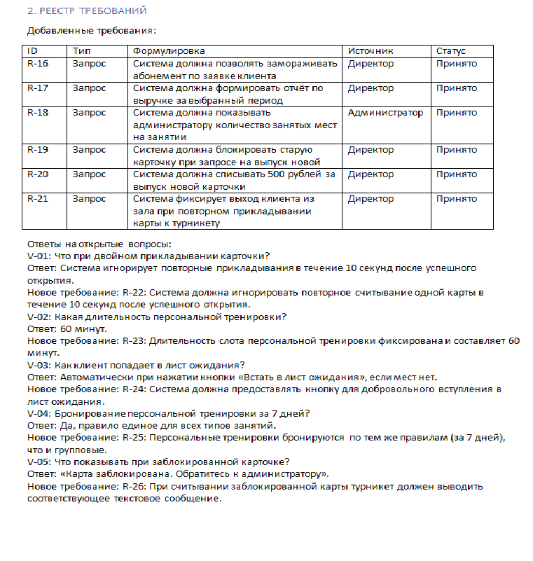
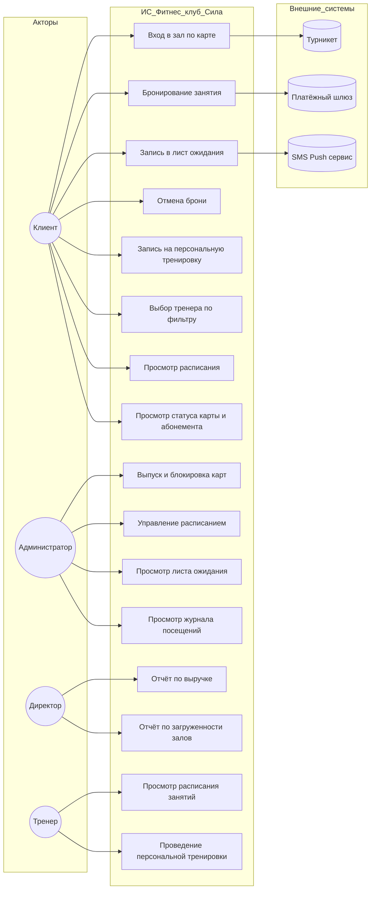
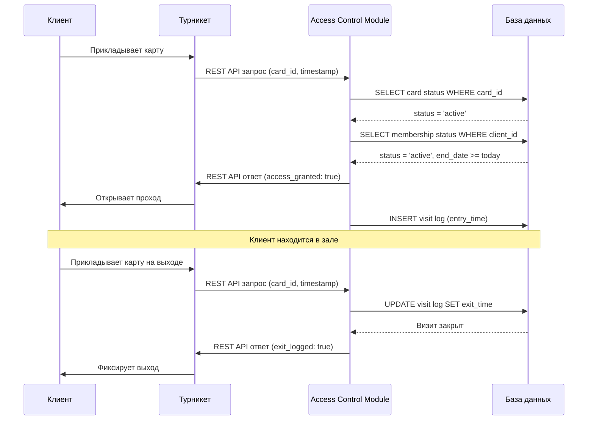
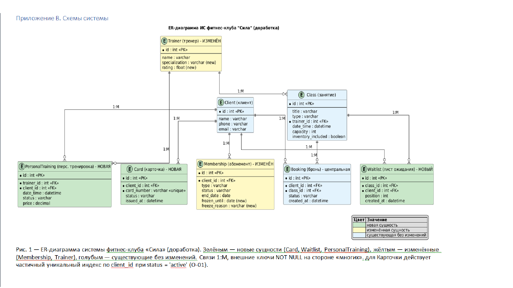
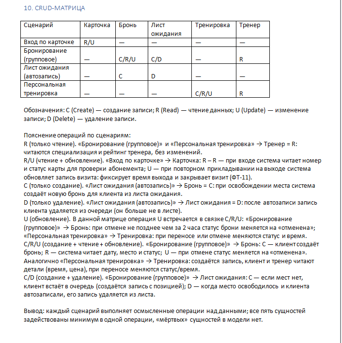
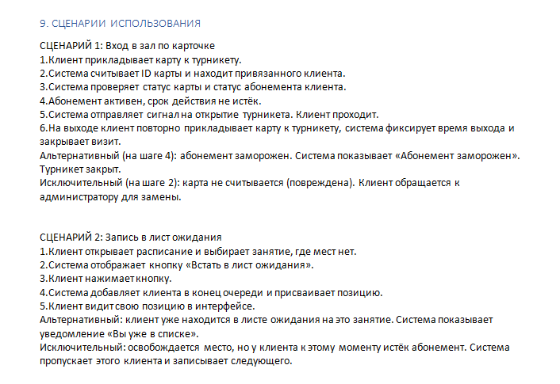
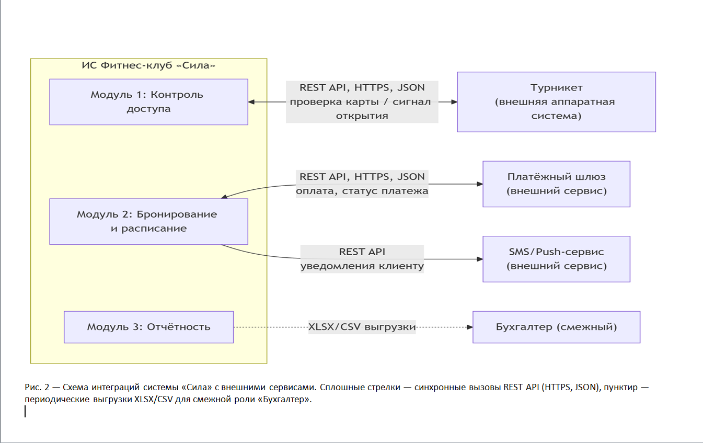

# 🏋️ Информационная система для фитнес-клуба "Сила"

**Дипломный проект профессиональной переподготовки**  
ТГУ + АНО ДПО «ЦМИППК»  
«Системный аналитик: с нуля до проектирования систем» (256 ч)

**Выполнила:** Кормачёва Юлия Александровна  
**Поток:** САС-101  
**Преподаватель:** Накостоев Адам Махмудович

---

## 📌 Описание проекта

Разработана спецификация требований (SRS) и спроектирована информационная система для управления фитнес-клубом. Система включает:

- Контроль доступа по картам с интеграцией турникета
- Бронирование групповых занятий и персональных тренировок
- Лист ожидания с автоматической записью
- Управление абонементами и картами клиентов
- Отчётность для директора и администратора

**Объём работы:** 26 требований (R-01…R-26), 11 функциональных и 4 нефункциональных требования, 5 сущностей модели данных, 2 интеграции с внешними системами.

---

## 🛠 Артефакты системного анализа

### 1. Требования

- **Функциональные требования** (ФТ-01 — ФТ-11)
- **Нефункциональные требования** (производительность, безопасность, надёжность)
- **Бизнес-правила** (R-01 — R-26)
- **User Stories** и **Use Cases**

#### Функциональные требования

*Рисунок 1 — Функциональные требования ФТ-01…ФТ-11*

#### Реестр требований

*Рисунок 2 — Исходный реестр требований (R-01…R-15, O-01…O-04)*

---

### 2. Моделирование процессов (BPMN)
- Процесс «AS IS» (текущий)
- Процесс «TO BE» (автоматизированный)
- Точки автоматизации
### 2.1. Процесс: Вход и выход клиента в зал (To-Be)

### 2.2. Процесс: Бронирование занятия и лист ожидания (To-Be)**

### 2.3. UML Use Case диаграмма

Диаграмма показывает взаимодействие акторов (пользователей и внешних систем) с функциональными возможностями ИС фитнес-клуба «Сила».

**Акторы и их роли:**
- **Клиент** — конечный пользователь: покупает абонемент, получает карту, бронирует занятия, входит в зал
- **Администратор** — операционный пользователь: управляет расписанием, выдаёт карты, работает с листом ожидания
- **Директор** — заказчик и спонсор: просматривает отчёты, принимает стратегические решения
- **Тренер** — проводит занятия: просматривает расписание, проводит персональные тренировки
- **Турникет** (внешняя система) — считывает карты, открывает/закрывает проход
- **Платёжный шлюз** (внешняя система) — обрабатывает оплаты за абонементы и перевыпуск карт
- **SMS/Push сервис** (внешняя система) — отправляет уведомления клиентам

### 3. Моделирование данных (UML/ER)
### 3.1. UML Sequence диаграмма: Вход в зал по карте

Диаграмма показывает последовательность взаимодействия между клиентом, турникетом, системой контроля доступа и базой данных при входе клиента в зал.

Участники диаграммы:
Клиент — инициирует процесс прикладыванием карты
Турникет — считывает карту, отправляет запрос в систему, открывает/закрывает проход
Access Control Module — обрабатывает запрос, проверяет статусы, логирует вход/выход
База данных — хранит данные о картах, абонементах и визитах
Ключевые моменты:
Синхронное взаимодействие через REST API (HTTPS, JSON)
Время ответа системы не более 2 секунд (НФТ-01)
При ошибке или таймауте турникет переходит в режим ручной проверки

### 3.2. ER-диаграмма

Модель данных системы фитнес-клуба «Сила». Зелёным выделены новые сущности (Card, Waitlist, PersonalTraining), жёлтым — изменённые (Membership, Trainer), голубым — существующие без изменений.

*Рисунок 3 — ER-диаграмма системы фитнес-клуба «Сила» (доработка)*

**Сущности системы:**

- **Client** (Клиент) — id, name, phone, email
- **Card** (Карточка) — id, client_id (FK), card_number (unique), status, issued_at
- **Membership** (Абонемент) — id, client_id (FK), type, status, end_date, frozen_until, freeze_reason
- **Class** (Занятие) — id, title, type, trainer_id (FK), date_time, capacity, inventory_included
- **Booking** (Бронь) — id, client_id (FK), class_id (FK), status, created_at
- **Waitlist** (Лист ожидания) — id, class_id (FK), client_id (FK), position, created_at
- **Trainer** (Тренер) — id, name, specialization, rating
- **PersonalTraining** (Персональная тренировка) — id, trainer_id (FK), client_id (FK), date_time, status, price

**Связи:** все связи типа 1:M, внешние ключи NOT NULL на стороне «многих». Для Card действует частичный уникальный индекс по client_id при status = 'active' (O-01).

---

### 3.3. CRUD-матрица

Матрица операций над сущностями по сценариям использования.

*Рисунок 4 — CRUD-матрица операций*

**Обозначения:** C (Create) — создание; R (Read) — чтение; U (Update) — изменение; D (Delete) — удаление.

**Вывод:** каждый сценарий выполняет осмысленные операции над данными; все пять сущностей задействованы минимум в одной операции, «мёртвых» сущностей в модели нет.

---

### 3.4. Сценарии использования

*Рисунок 5 — Сценарии использования (вход в зал по карточке, запись в лист ожидания)*

---

### 4. Спецификация API

#### 4.1. Схема интеграций

Схема интеграционных взаимодействий системы «Сила» с внешними сервисами.

*Рисунок 6 — Схема интеграций системы «Сила» с внешними сервисами*

**Интеграция 1: Турникет (Система контроля доступа)**
- **Тип:** синхронная интеграция
- **Протокол:** REST API (HTTPS)
- **Формат:** JSON
- **Запрос:** `{"card_id": "12345", "timestamp": "2026-09-09T18:00:00"}`
- **Ответ:** `{"access_granted": true/false, "reason": "active/frozen/expired/blocked"}`
- **Обработка ошибок:** при таймауте (>3 сек) — переход в режим ручной проверки

**Интеграция 2: Платёжный шлюз**
- **Тип:** синхронная интеграция
- **Протокол:** REST API (HTTPS)
- **Формат:** JSON
- **Запрос:** `{"payment_id": "...", "amount": 500, "currency": "RUB"}`
- **Ответ:** `{"status": "success/failed"}`
- **Обработка ошибок:** при ошибке — откат операции, до 3 ретраев через 5 секунд

---

## 🎓 Ключевые результаты

### Сущности системы:
- **Клиент** (Client)
- **Карточка** (Card) — новая
- **Абонемент** (Membership) — изменён
- **Занятие** (Class)
- **Бронь** (Booking)
- **Лист ожидания** (Waitlist) — новая
- **Тренер** (Trainer) — изменён
- **Персональная тренировка** (PersonalTraining) — новая

### Основные функции:
✅ Выпуск/блокировка карт доступа  
✅ Проверка активного абонемента при входе (не более 2 секунд)  
✅ Бронирование занятий (7 дней вперёд)  
✅ Отмена брони (не позднее чем за 2 часа)  
✅ Автоматическая запись из листа ожидания (position = 1)  
✅ Фиксация входа/выхода через турникет  
✅ Уведомления (push/SMS/email)  
✅ Отчётность по выручке и загруженности залов  
✅ Фильтрация расписания по тренеру (специализация, рейтинг)  
✅ Разграничение доступа по залам (бокс, дзюдо)

---

## 💡 Навыки, продемонстрированные в проекте

- **Сбор и формализация требований** — интервью со стейкхолдерами, анализ бизнес-процессов, протокол интервью
- **Моделирование BPMN** — процессы AS IS и TO BE, выявление точек автоматизации
- **Проектирование БД** — нормализация, ER-моделирование, частичные уникальные индексы
- **UML-диаграммы** — Use Case, Sequence
- **API-интеграции** — REST, JSON, спецификации эндпоинтов, обработка ошибок
- **CRUD-анализ** — матрица операций, трассировка требований
- **SQL** — примеры запросов (дубликаты email, очередь листа ожидания, выручка за период)

---

##  Документы проекта

- 📄 [Полная спецификация SRS (PDF)](Кормачёва_SRS_фитнес-клуб_Сила.pdf)
- 📄 [Итоговая аттестационная работа (DOCX)](Кормачёва_Ю_САС-101_ИАР.docx)

---

## 👤 Автор

**Кормачёва Юлия Александровна**  
📍 Можайск (готова к удалённой работе)  
💼 Портфолио: [github.com/yul13166759/portfolio-julia-kormacheva](https://github.com/yul13166759/portfolio-julia-kormacheva)  
📧 Email: [ykormacheva13166759@gmail.com](mailto:ykormacheva13166759@gmail.com)  
 Telegram: [@Julia_3105](https://t.me/Julia_3105)  
🔗 GitHub: [github.com/yul13166759](https://github.com/yul13166759)
